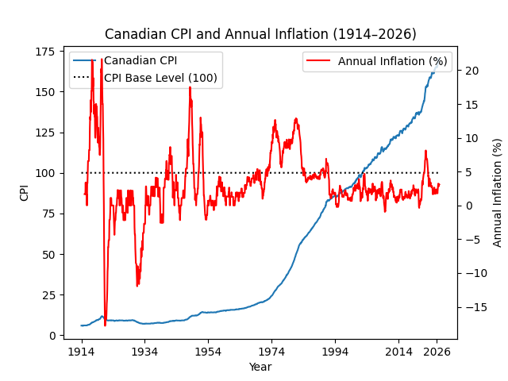

# FINE3300-2026-A2: Canadian Inflation Calculator

## Introduction

A Canadian Inflation Calculator developed using Python for FINE 3300 Assignment 2.

The program uses Canadian Consumer Price Index (CPI) data to calculate how the value of money changes between two selected months and years.

The calculator determines the adjusted price, percentage change, elapsed years, and annualized inflation rate. It also creates a graph showing historical Canadian CPI and annual inflation.

## Files

- InflationCalculator.py — Python code for the inflation calculator and graph.
- CPI.csv — Canadian Consumer Price Index data.
- CPI_Graph.png — Graph showing Canadian CPI and annual inflation.
- README.md — Project description, instructions, and results.

## How to Run

1. Download the Python file and CPI dataset into the same folder.
2. Open the folder in VS Code.
3. Make sure Python, Pandas, and Matplotlib are installed.
4. Open the terminal and run:

   `python3 InflationCalculator.py`

5. Enter the original price, starting year and month, and ending year and month.
6. The program displays the inflation calculations and opens the CPI graph.

## Example Output

The following example calculates the inflation-adjusted value of $100 between January 2020 and January 2025.

| Calculation | Result |
|---|---|
| Original Price | $100.00 |
| Starting Date | January 2020 |
| Ending Date | January 2025 |
| Starting CPI | 136.8 |
| Ending CPI | 161.3 |
| Adjusted Price | $117.91 |
| Percentage Change | 17.91% |
| Number of Years | 5.00 |
| Annual Inflation Rate | 3.35% |

## Canadian CPI and Annual Inflation Graph

The graph shows Canadian CPI and annual inflation from 1914 to 2026.

The blue line represents CPI, which generally increases over time, showing that the overall price level in Canada has risen.

The red line represents annual inflation, which fluctuates considerably. Inflation increased significantly during the 1970s and early 1980s, with another noticeable increase around 2022.

The graph uses a second vertical axis for annual inflation percentages. The dotted horizontal line represents the CPI base level of 100.

Overall, the graph shows that even when inflation slows, the CPI can continue rising.

## Input Validation

The calculator checks for negative or zero prices, invalid months, dates entered in the wrong order, and dates unavailable in the CPI dataset.

The program expects numerical inputs for prices, months, and years.

## Data Source

Bank of Canada — Inflation Calculator and Canadian Consumer Price Index data.

https://www.bankofcanada.ca/rates/related/inflation-calculator/

